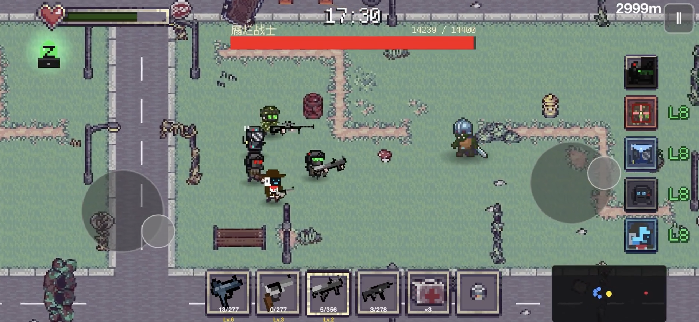

[English](README.md) | [中文](README.zh.md)

# Z Squad

**Keep your squad alive in a city overrun by zombies.**

A pixel-art survival game for iOS, built by Yidong Li in **Swift and SpriteKit**. Play solo with AI companions or team up through local two-player co-op.

[Website & player support](https://zsquad.app/) · [Developer](https://github.com/yil337) · [LinkedIn](https://www.linkedin.com/in/yidong-li-dev/)



## The game

Z Squad brings squad-based combat into a mobile survival run. Procedural city layouts, enemy encounters and companion behavior have to work together on a small screen, with touch controls and a second player sharing the action.

The game is currently in TestFlight testing. This repository contains its **public website and project showcase**; the native game source is maintained privately.

## What I built

- **Gameplay and world systems.** Combat, enemy encounters, progression and procedural city generation in SpriteKit.
- **Companion AI.** Squad members that participate in combat alongside the player, with behavior integrated into the game's movement and encounter systems.
- **Local co-op.** Nearby-device play using Apple's MultipeerConnectivity framework over Wi-Fi or Bluetooth.
- **A content-authoring workflow.** A browser-based room editor that exports layouts for use in the native game, so content iteration does not require hand-editing every layout in Swift.

I work across gameplay programming, game design, interface implementation and supporting tools. The game also uses third-party art and audio, credited in-game.

## Engineering focus

| Part | Implementation |
| --- | --- |
| Runtime | Swift + SpriteKit |
| World and encounters | Procedural city layouts, enemies and squad combat |
| Multiplayer | MultipeerConnectivity for local two-player sessions |
| Content tools | Browser-based editor with game-ready exports |
| This repository | Static HTML/CSS/JavaScript website, deployed with GitHub Pages |

## Preview the website locally

With Python 3 installed:

```bash
git clone https://github.com/yil337/squad-z.git
cd squad-z
python3 -m http.server 8000
```

Open **http://localhost:8000** for the website. These commands serve the support site, not the iOS game.

For gameplay questions and bug reports, use the [support information on the website](https://zsquad.app/).
