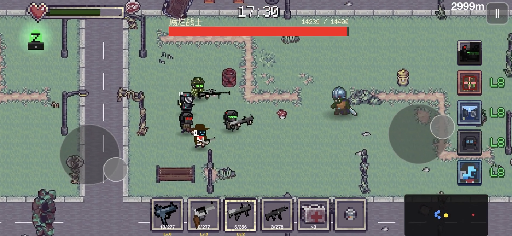

[English](README.md) | [中文](README.zh.md)
<!-- Synced with README.md as of 2026-10-02 -->

# Z Squad

**在被僵尸占据的城市里，带着小队活下去。**

我是李奕东，这是我用 **Swift 和 SpriteKit** 开发的像素风 iOS 生存游戏。你可以带着 AI 队友单人闯关，也可以通过本地双人联机与朋友合作。

[官网与玩家支持](https://zsquad.app/) · [开发者](https://github.com/yil337) · [LinkedIn](https://www.linkedin.com/in/yidong-li-dev/)



## 游戏在做什么

我想把小队战斗放进一局随时能开始的手机生存游戏里。程序化城市、敌人遭遇和队友行为需要相互配合，同时适应触屏操作，以及第二位玩家加入后的战斗节奏。

游戏目前处于 TestFlight 测试阶段。这个仓库用于**官网和项目展示**，原生游戏源码保持私有。

## 我负责的部分

- **玩法与世界系统**：用 SpriteKit 实现战斗、敌人遭遇、成长机制和程序化城市生成。
- **队友 AI**：让小队成员随玩家移动并参与战斗，将行为逻辑接入移动和遭遇系统。
- **本地双人联机**：通过 Apple MultipeerConnectivity，使用 Wi-Fi 或蓝牙连接附近设备。
- **内容编辑工具**：制作浏览器端房间编辑器，将布局导出给原生游戏使用，减少在 Swift 中手动修改场景的工作。

我的工作涵盖玩法编程、游戏设计、界面实现和配套工具。游戏使用了第三方美术与音频素材，作者列于游戏内致谢。

## 技术构成

| 部分 | 实现 |
| --- | --- |
| 游戏运行时 | Swift + SpriteKit |
| 世界与战斗 | 程序化城市、敌人与小队战斗 |
| 联机 | MultipeerConnectivity 本地双人会话 |
| 内容工具 | 浏览器编辑器与游戏可用的导出数据 |
| 当前仓库 | HTML/CSS/JavaScript 静态网站，使用 GitHub Pages 部署 |

## 本地查看官网

需要 Python 3：

```bash
git clone https://github.com/yil337/squad-z.git
cd squad-z
python3 -m http.server 8000
```

打开 **http://localhost:8000**。这里启动的是支持网站，不能直接运行 iOS 游戏。

玩法问题与 bug 反馈请使用[官网上的联系方式](https://zsquad.app/)。
